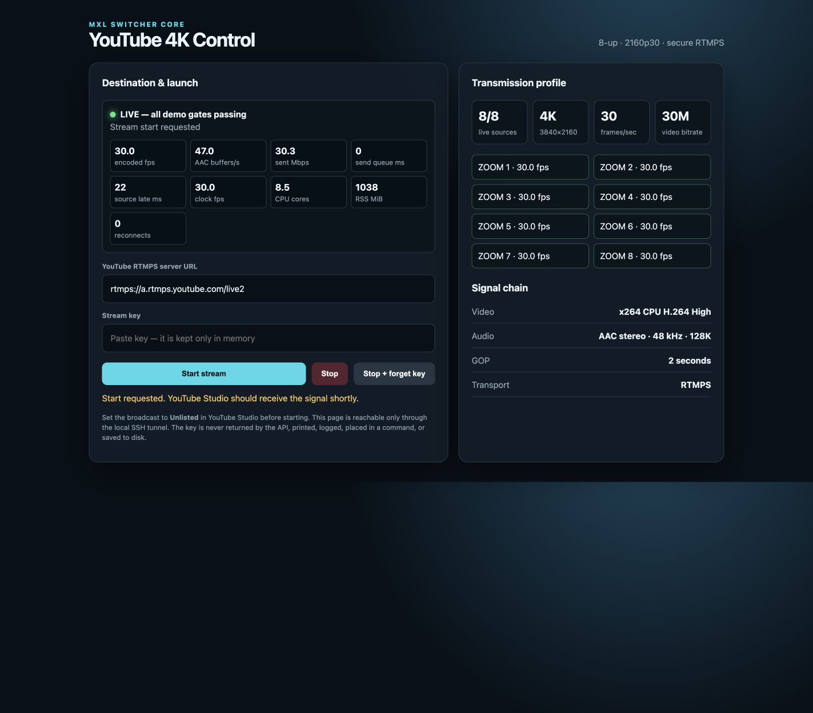

# MXL Switcher Technical Preview

This technical preview packages the smallest end-to-end path that has been
demonstrated and can be reproduced without private project history. It is an
honest integration preview, not a claim that every extension is ready for
unattended broadcast operation.

## Supported demonstration path

The primary path is one modern x86-64 Linux host running:

```text
licensed ZoomISO Cloud MXL outputs
              |
              v
       MXL Switcher Core
        |      |      |
        v      v      v
     Program Preview multiview -> ATEM-style browser Skin
        |
        v
CPU 3840x2160p30 composition + Program audio -> YouTube RTMPS
```

Use the [end-to-end quickstart](../QUICKSTART.md). The public launcher owns
only its seven labelled containers, keeps its controllers on loopback, obtains
fresh flow identities on every launch, and retains the YouTube key only in the
controller process.

The demonstrated eight-source profile used 32 modern logical CPUs and 128 GiB
RAM. Four-source rehearsals can start smaller, but every accepted run must
retain measured headroom. The older lab host is useful for constrained testing
but is not a supported eight-source 1080p30 baseline.

## What the evidence supports

| Capability | Evidence-backed status |
| --- | --- |
| ZoomISO MXL contribution | Eight paired source video/audio flows discovered and operated through the guarded bundle |
| Core routing | Stable Program and Preview identities, operator Preview/Take, zero hard-counter movement in the published caveat-zero rehearsal |
| Operator confidence | Advancing Program, Preview, and one eight-source multiview wall with an ATEM-style browser Skin |
| YouTube output | CPU-only 3840x2160p30 eight-source composition, Program audio, diagnostic timecode, and RTMPS delivery demonstrated on a modern 32-vCPU cloud host |
| NDI input | Experimental two-source, video-only split-copy path passed strict 60-second and 180-second clean-host gates on a modern 16-vCPU receiver using two full-bandwidth ZoomISO NDI outputs over a private network |
| Portability | Azure is the demonstrated CPU reference; comparable Google Cloud and AWS machines are candidates until independently qualified |

The public NDI result measured both 1080p29.97 sources at approximately 30 fps,
at most one frame of skew, zero holds, skips, catch-up, restarts, alarms, and
Core hard-counter movement. The NDI bank peaked below two CPU cores and retained
more than 88 percent whole-host idle on the tested 16-vCPU receiver. This is a
specific two-source video result, not a universal NDI-versus-MXL benchmark.
HX2/HX3 PTZ senders exercised on the shared older lab host did not meet the
strict no-skip gate. That result combined decode and host contention and does
not isolate the codec, so those senders and that host profile remain
unqualified.

## Public proof images

The repository includes public-safe proof from the reference demonstration. The
source canvas intentionally obscures participant imagery while preserving the
eight-live-source topology; the controller image exposes aggregate media and
resource telemetry without a stream key.




## Explicit limitations

The following remain experimental and are not part of the supported technical
preview claim:

- unattended ZoomISO meeting recovery and remapping;
- the eight-source audio mix's long audience A/V acceptance gate;
- NDI bank audio, seamless source replacement, more than two inputs, and every
  NDI codec or sender combination;
- meeting-to-meeting Program return;
- SRT, DeckLink, recording/replay, and TAMS production profiles;
- multi-host MXL fabrics; and
- eight simultaneous 1080p30 sources on the older lab host.

Do not describe this preview as a production appliance. The broader
[broadcast-readiness plan](BROADCAST_READINESS.md) remains the promotion
contract.

## Release-candidate exit gate

Before tagging a technical-preview release candidate, a fresh operator must:

1. begin with only the public repository and documented licensed prerequisites;
2. complete `init`, `preflight`, `up --apply`, `check`, and `down --apply`;
3. require no source-code edits, private handoff notes, or manually copied flow
   identities;
4. verify picture movement, audible Program audio, bounded CPU/RSS, zero
   restarts, and zero Core hard-counter movement; and
5. leave ZoomISO and all unrelated services untouched after cleanup.

Use the [outsider rehearsal](../deploy/online-demo/OUTSIDER_REHEARSAL.md) to
record that result. Fix documentation and packaging defects found by the
rehearsal, but add no new features during this release-candidate phase.

## Product decision after the preview

The next engineering investment is selected by real operator or design-partner
feedback. The likely choices are either objective Program-return A/V acceptance
or NDI audio plus deterministic source-replacement recovery. Until a concrete
pilot identifies one of those as a blocker, the project prioritizes packaging,
proof, and operator feedback over another speculative runtime track.

Organizations evaluating a real workflow can use the
[design-partner pilot](DESIGN_PARTNER_PILOT.md) to define a bounded decision and
its acceptance evidence.
