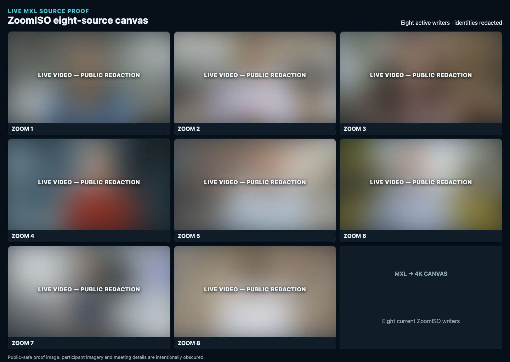
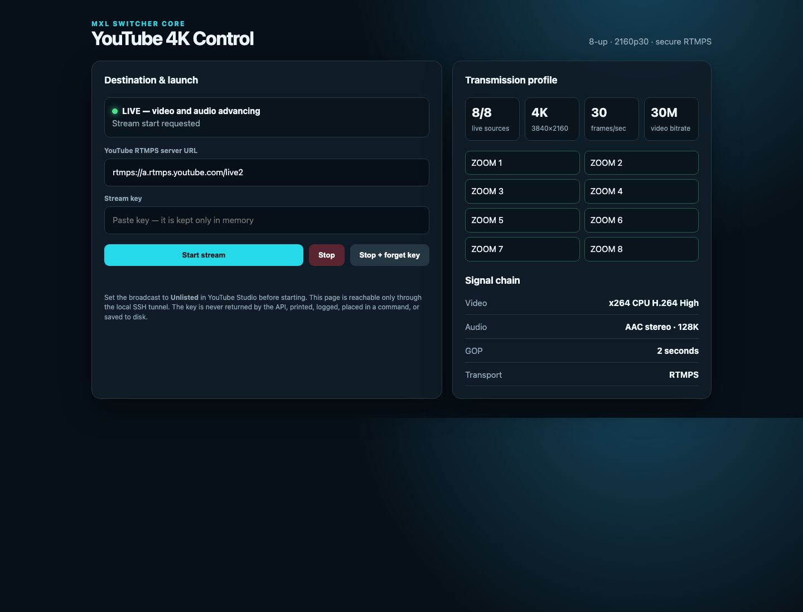

# RTMP/RTMPS output

Direct Program Master encode for services such as YouTube.

**Maturity: prototype.** The executable path reads MXL video and audio directly,
uses hardware H.264 encoding, and sets the RTMPS destination through the
GStreamer API on the modern `rtmp2sink` implementation after reading a
mode-0600 secret file. The original Switcher's
RTSP-derived, timestamp-regenerating path is retained only as a lesson.

The direct multi-view mode builds a 3840x2160p30 canvas from four or eight MXL
video sources. Four-up is a 2x2 layout of native-resolution 1920x1080 tiles and
is the preferred local proof profile. Eight-up uses eight 1280x720 tiles in a
3x3 canvas with a branded ninth cell. Both feed NVENC directly, avoiding an
unnecessary 4K uncompressed intermediate flow while remaining independent of
Core.

## Boundary

The adapter reads stable Program video and Program audio directly from MXL. It
owns encoding, FLV muxing, RTMPS transport, retry policy, and destination
health. It never decodes the WebRTC confidence rendition and never adds codecs
or cloud credentials to Core.

A destination profile explicitly selects resolution, frame rate, H.264
bitrate/profile, GOP duration, AAC bitrate/sample rate, reconnect policy, and
the target service. The YouTube 4K prototype is 3840x2160p30, H.264 High at
30,000 Kbps CBR, a two-second GOP, two B-frames, and stereo AAC at 128 Kbps /
44.1 kHz. Service-specific requirements override only the adapter profile,
never Program Master.

## YouTube 4K proof

Create the key file on the media host without putting the key in shell history:

```bash
install -m 600 /dev/null "$HOME/.youtube-stream-key"
read -rsp 'YouTube stream key: ' key
printf '%s' "$key" > "$HOME/.youtube-stream-key"
unset key
```

Launch with exactly four or eight `--input 'LABEL=FLOW_UUID'` arguments. The canvas,
Program audio, encoder, mux, and secure transport are one supervised output:

```bash
python3 outputs/rtmp/rtmps_output.py \
  --domain /mxl-domain \
  --audio-flow "$PROGRAM_AUDIO_FLOW" \
  --stream-key-file "$HOME/.youtube-stream-key" \
  --input 'SOURCE 1=...' --input 'SOURCE 2=...' \
  --input 'SOURCE 3=...' --input 'SOURCE 4=...'
```

For the operator path, launch `youtube_control.py` with the shared MXL domain
and Program audio flow. It serves a loopback-only control window on port 18121,
automatically discovers four active ZoomISO video outputs by default, and accepts the
YouTube RTMPS server and masked stream key. The key remains only in process
memory and is never returned by the API, logged, written to disk, or placed in
process arguments. Use an SSH tunnel rather than exposing the control port:

```bash
ssh -N -L 18121:127.0.0.1:18121 media-host
```

Then open `http://127.0.0.1:18121/`.

Use `--source-count 8` to select the original eight-up layout. Discovery keeps
one freshest writer for each numbered ZoomISO output and tolerates the source's
normal metadata update cadence without presenting duplicate inputs. On a host
running multiple identically named ZoomISO instances, repeat `--preferred-flow`
with the intended instance's four or eight video flow IDs to prevent a source
number from switching between writers.

When containerized, bind the process to `0.0.0.0` with the explicit
`--container-bind` acknowledgement, but publish it only as
`127.0.0.1:18121:18121` on the media host. Never publish the control window on
the LAN or Internet.

Health is loopback-only on port 18120. A green readiness response requires
advancing encoded video, advancing encoded audio, and fresh mux output.

`Dockerfile.nvidia` layers the userspace CUDA/NVENC libraries that match the
Ubuntu 24.04 NVIDIA 580 guest driver onto the existing MXL media image. Run the
container with the NVIDIA character devices made available by the host; do not
use a privileged container.

## Secret contract

- The stream key is a secret reference, not ordinary configuration.
- Read it at runtime and set the sink location through the GStreamer API. It
  must never appear in argv, process listings, logs, health JSON, screenshots,
  evidence bundles, or Git.
- Public state reports only a redacted destination label and service type.
- Reject URLs containing userinfo, fragments, control characters, or an
  unapproved scheme. Production profiles require `rtmps://`.
- Bind health and control to loopback by default.

An argv-only `gst-launch` wrapper cannot meet this stream-key requirement and
is therefore not the production implementation.

## Readiness and telemetry

Process liveness or an open TCP socket is not readiness. Green requires:

- advancing encoded video and audio into `flvmux`;
- advancing bytes through the RTMPS sink;
- bounded encoder/mux queues;
- a connected destination with no active retry; and
- receiver- or platform-side stream health during promotion.

Publish encoder fps, audio sample rate, encoded bitrates, mux bytes, bytes
sent, queue depth, reconnects, current backoff, last successful write age,
CPU, and RSS. If a platform health API is configured, expose only its
non-secret health state and latency.

## Promotion sequence

1. Unit-test secret redaction, URL validation, queue bounds, GOP, bitrate,
   audio profile, and bounded retry behavior.
2. Run a local RTMP/RTMPS receiver and independently decode/count both
   essences. Presence alone is insufficient.
3. Prove Program flow replacement reopens video and audio together.
4. Run sustained clean-path cadence, content-level A/V offset/drift, and
   CPU/RSS gates.
5. Exercise disconnect/reconnect without duplicate writers or unbounded
   buffering.
6. Run the real service profile and verify audience-side picture, sound, and
   platform stream health.

Only after those gates pass should the extension move from `prototype` to
`candidate`.

## Real-service transport gate — 2026-10-16

An unlisted CPU-only YouTube run on a 32-vCPU, 128 GiB general-purpose cloud
VM with no GPU proved that the x264/AAC/FLV/RTMPS path could deliver good
picture, sound, and smoothly moving diagnostic timecode to the audience
player. It did **not** prove the intended eight-participant composition: the
operator did not see the Zoom participants in the YouTube output.

Treat this run as a transport-only success and an eight-source composition
failure/unverified gate. Do not describe it as an end-to-end Zoom participant
demonstration. The next gate must visibly identify all eight live tiles at the
controller and audience outputs, reject diagnostic or stale source selection,
and capture synchronized resource and receiver telemetry before shutdown.

### Eight-source rebuild evidence

The follow-up rebuild selected eight distinct live ZoomISO MXL writers and the
loopback-only controller reported advancing video and audio for a CPU-encoded
3840x2160, 30000/1001-fps, 30 Mbps RTMPS output. The two public-safe captures
below intentionally omit the stream key, meeting details, participant
identities, private addresses, and flow identifiers.





These images prove controller-side source selection and transmission state;
they are not, by themselves, an audience-player acceptance result. Promotion
still requires a separate YouTube audience screenshot showing the intended
eight-tile composition plus platform health while the same run is active.
